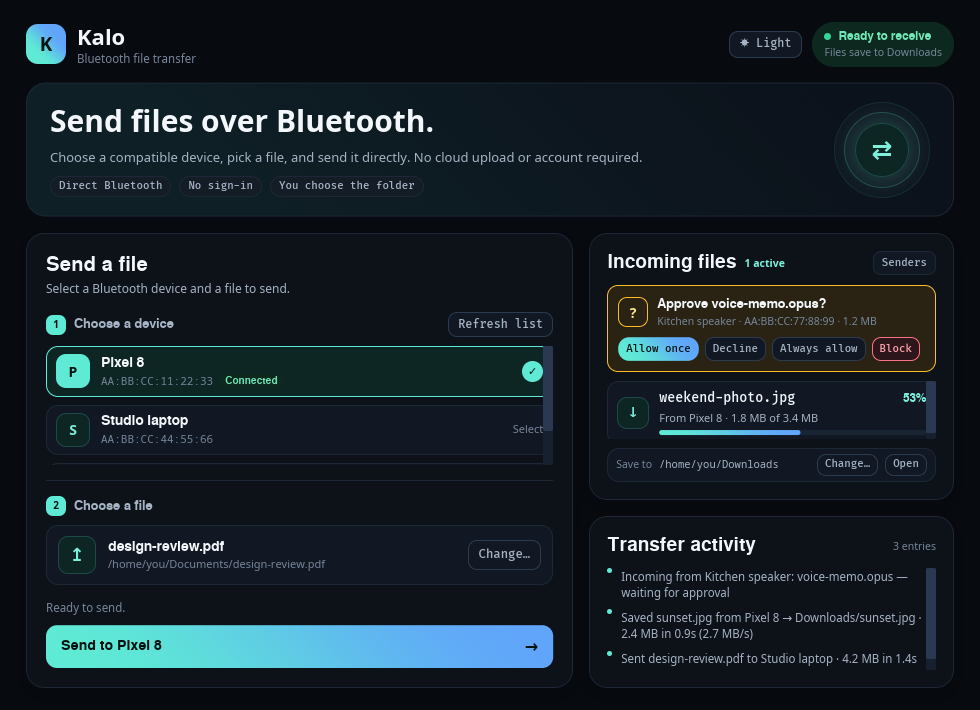
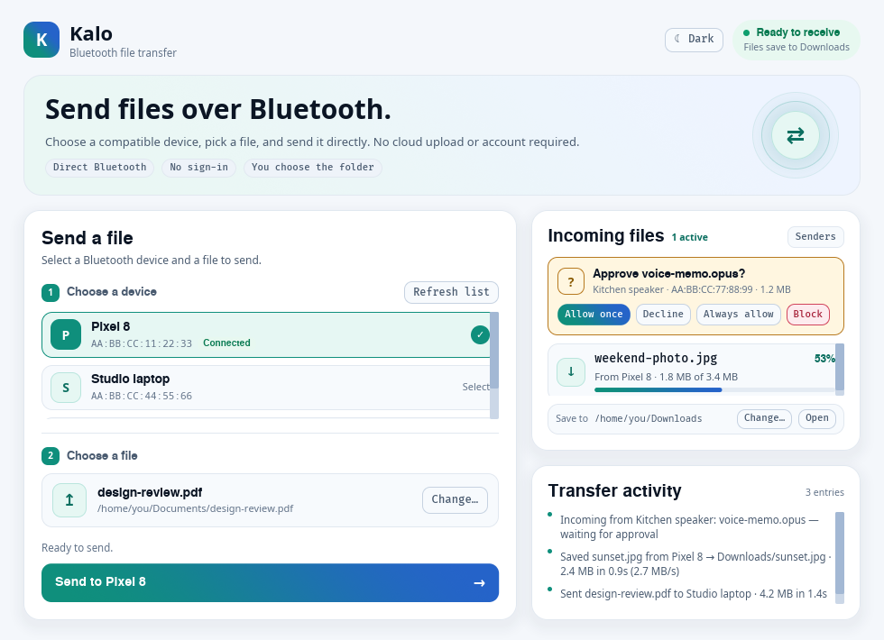

<p align="center">
  
</p>

# Kalo

**Direct Bluetooth file transfers for Linux. Experimental Windows support.**

Kalo is a native desktop app for sending and receiving files over Bluetooth. Choose a device, pick a file, and send it directly — without cables, an account, or a cloud upload. The name comes from Albanian: **kalo means “to pass”**, like a file passing from one device to another.

Built with **Rust** and **[iced](https://iced.rs/)**, Kalo provides a desktop interface and a command-line interface (CLI). Transfers use **Bluetooth Object Push Profile (OPP/OBEX)**, so the other device must support that profile.

> **Project status — early development (Phase 0).** Ubuntu and Arch Linux are the current Linux targets. A native Windows backend has been implemented, but **has not been validated on real Windows hardware**. GitHub Actions publishes the latest successful Ubuntu `.deb`, Arch Linux package and experimental Windows builds; Arch users can also build `kalo-git` from the included `PKGBUILD`.

> **Incoming files and trust:** Kalo asks before accepting a file from a new sender. The desktop UI offers **Allow once**, **Always allow**, **Decline** and **Block**; allow and block decisions are remembered by Bluetooth address. You can also switch the receiver to **Trusted only** and manage remembered senders. The CLI receiver cannot show a prompt, so it rejects unknown senders. On Windows, senders whose Bluetooth address cannot be resolved are never remembered.

## Screenshots

<p align="center">
  
  
</p>

<p align="center"><sub>Dark and light themes, shown with fictional demo data.</sub></p>

## Features

- **Send files directly:** select a Bluetooth device known to your computer, choose a file, and start an OPP transfer.
- **Approve incoming senders:** allow a file once, remember the sender, decline, or block. Choose **Trusted only** to reject unknown senders without prompting.
- **See transfer progress:** follow outgoing transfers and incoming files in the desktop UI.
- **Cancel a send:** interrupt an outgoing transfer, including during connection setup. Stalled transfers are detected.
- **Choose where files go:** received files are written to a temporary staging area and moved to your save folder, which defaults to the platform Downloads folder. A completed transfer offers an **Open folder** action.
- **Switch themes:** use the dark **Kalo Midnight** or light **Kalo Daylight** appearance; the preference is remembered.
- **Keep Kalo in the panel:** on Linux, closing the window hides it to the status area when a StatusNotifierItem host is available.
- **Track activity:** view transfer results, errors, and receiver status in the app.
- **Use the CLI:** inspect adapters and devices, discover and pair, check receiver availability, and send or receive files from a terminal.

Kalo does not use a hosted service for file transfer and does not require sign-in.

## Platform support

| Platform | Current status | Packaging |
| --- | --- | --- |
| Ubuntu | Supported Linux target | Download the latest `.deb` or build it locally |
| Arch Linux / Omarchy | Supported Linux target | Download the latest `kalo-git` package or build it from the included `PKGBUILD`; not yet published to the AUR |
| Windows 10/11 | **Experimental; not yet tested on physical Windows hardware** | Download the latest portable ZIP or `.exe`; no installer |

## Requirements and compatibility

- A working Bluetooth adapter on the computer.
- A recipient that supports **Bluetooth OPP (Object Push Profile)** to receive files. Bluetooth support alone does not guarantee file-transfer compatibility.
- Pair the devices through your operating system's Bluetooth settings before sending, or use `kalo pair <MAC>` where supported. The desktop UI lists devices already **known to the operating system**; its **Refresh list** button reloads that list, rather than initiating a new discovery scan.

**Ubuntu runtime dependencies:**

```sh
sudo apt install bluez bluez-obexd
```

**Arch Linux runtime dependencies:**

```sh
sudo pacman -S bluez bluez-obex
```

On Linux, Kalo uses BlueZ and `obexd`, plus an XDG desktop portal for the file picker. Ubuntu Desktop typically provides a portal; on Arch, install `xdg-desktop-portal-gtk`, or `xdg-desktop-portal-hyprland` on Hyprland/Omarchy, or another compatible portal backend if needed. No **separate Kalo daemon** needs to be enabled.

The Linux status-area icon uses StatusNotifierItem. KDE Plasma, Cinnamon, XFCE and Omarchy's Waybar (with its `tray` module) provide a host out of the box; GNOME needs an extension such as **AppIndicator and KStatusNotifierItem Support**. Without a compatible host, Kalo closes normally instead of hiding to the tray.

On Windows, Kalo uses WinRT Bluetooth APIs and its own RFCOMM/OBEX implementation; BlueZ, `obexd`, and D-Bus are not required. This path is still experimental, and there is no notification-area icon on Windows yet.

To compile from source, use a recent Rust toolchain (edition 2024; Rust 1.98 or newer is documented as working). Windows builds require the MSVC Rust toolchain, Visual Studio Build Tools, and the Windows SDK.

## Install and launch

### Download the latest build

GitHub Actions publishes stable asset names, so these links always resolve to the newest successful build:

- **Ubuntu `.deb`:** [kalo_amd64.deb](https://github.com/Ogalesha/Kalo/releases/latest/download/kalo_amd64.deb)
- **Arch Linux / Omarchy package:** [kalo-git-x86_64.pkg.tar.zst](https://github.com/Ogalesha/Kalo/releases/latest/download/kalo-git-x86_64.pkg.tar.zst)
- **Windows portable ZIP (experimental):** [kalo-windows-x64.zip](https://github.com/Ogalesha/Kalo/releases/latest/download/kalo-windows-x64.zip)
- **Windows standalone executable (experimental):** [kalo-windows-x64.exe](https://github.com/Ogalesha/Kalo/releases/latest/download/kalo-windows-x64.exe)
- **Checksums:** [SHA256SUMS.txt](https://github.com/Ogalesha/Kalo/releases/latest/download/SHA256SUMS.txt)

All published builds are listed on the [releases page](https://github.com/Ogalesha/Kalo/releases). The Arch package and the Windows builds are unsigned; verify downloaded files against the checksums.

### Ubuntu

Install the downloaded package:

```sh
sudo apt install ./kalo_amd64.deb
kalo
```

Or build from the root of a local checkout:

```sh
./packaging/ubuntu/build-deb.sh
sudo apt install ./dist/kalo_0.1.0-1_amd64.deb
kalo
```

The locally built `.deb` targets the architecture and glibc version of the build machine; it may not work on older Ubuntu releases. See [Ubuntu packaging notes](packaging/ubuntu/README.md).

Remove it with `sudo apt remove kalo`.

### Arch Linux / Omarchy

Install the downloaded package (the file is named `kalo-git-x86_64.pkg.tar.zst`
and installs the `kalo-git` package):

```sh
sudo pacman -U kalo-git-x86_64.pkg.tar.zst
kalo
```

Or build the package from the root of a local checkout:

```sh
sudo pacman -S --needed base-devel git rust cargo
cd packaging/arch
makepkg -si
kalo
```

Both paths install the same `PKGBUILD` metadata, desktop entry, icon and manual
page. The package uses the current `main` branch. It is **not yet published to
the AUR**. See [Arch packaging notes](packaging/arch/README.md).

### Windows (experimental)

Download `kalo-windows-x64.zip`, unpack it, and run `kalo.exe`. You can also download the standalone `kalo-windows-x64.exe`. These builds are unsigned, so Windows SmartScreen may show a warning.

To build from the root of a Windows checkout with the MSVC toolchain installed:

```powershell
powershell -ExecutionPolicy Bypass -File packaging\windows\build-zip.ps1
```

Unpack the generated `dist\kalo-<version>-<arch>.zip` and run `kalo.exe`. There is no Windows installer, notification-area icon, or background receiver service yet. See [Windows packaging notes](packaging/windows/README.md).

### Run directly from source

```sh
cargo build --release
./target/release/kalo
```

On Windows, run `.\target\release\kalo.exe` instead. `kalo ui` explicitly opens the graphical interface on either supported build target.

## How to use Kalo

### Send a file

1. Turn on Bluetooth and pair the destination device using your system settings.
2. Make sure the destination can receive Bluetooth OPP file transfers.
3. Open Kalo. Under **Choose a device**, select the destination; use **Refresh list** if you have just paired it.
4. Under **Choose a file**, select the file to send.
5. Select **Send to [device]**. Kalo shows progress and lets you cancel the outgoing transfer.

The recipient may need to accept the transfer, depending on its own Bluetooth software.

### Receive a file

1. Open Kalo and check the receiver status at the top of the window. When it says **Ready to receive**, another compatible device can send a file to this computer.
2. The first time a sender is seen, an approval card shows the sender, Bluetooth address, file name and size. Choose **Allow once**, **Always allow**, **Decline** or **Block**. If the address is unknown, only the one-time choices are offered.
3. Watch progress under **Incoming files**. Completed files are saved to the folder shown under **Save to**; use **Open folder** to reveal the saved file or the destination folder.

Use **Senders** to review remembered devices, remove a decision, or switch between **Ask** and **Trusted only**. **Trusted only** rejects unknown senders without showing a prompt. The CLI receiver has no prompt and rejects unknown senders; run the desktop app to approve new devices.

**Important:** acceptance also depends on the operating system's Bluetooth stack. On Linux, a different program (such as Blueman's transfer service) may already own the OBEX agent registration. Close or disable the conflicting receiver; Kalo retries automatically. On Windows, Kalo must stay open to receive files.

## Command-line interface

```text
kalo                         Open the desktop UI
kalo ui                      Open the desktop UI
kalo adapters                List Bluetooth adapters and their state
kalo connectable [on|off]    Show or set adapter connectability (show-only on Windows)
kalo devices [--discovery N] List known devices; optionally discover for N seconds
kalo pair <MAC>              Pair with a device
kalo agent-check             Check whether the receiver can start
kalo send <MAC> <FILE>       Send a file via Bluetooth OPP
kalo receive                 Run the receiver in the foreground
```

For example:

```sh
kalo devices --discovery 15
kalo pair AA:BB:CC:DD:EE:FF
kalo send AA:BB:CC:DD:EE:FF path/to/file.pdf
```

## How it works (technical overview)

**Outgoing transfers:** Kalo selects a device and sends a file using Bluetooth OPP/OBEX. On Linux, it delegates the OBEX transfer to `obexd` through D-Bus; on Windows, its experimental backend connects to the remote OPP service using WinRT RFCOMM and a built-in OBEX engine. Progress, cancellation, and stall handling are reported to the UI or CLI.

**Incoming transfers:** Kalo starts a receiver when the UI runs (or when `kalo receive` is invoked). Before a transfer is accepted, the shared authorizer checks the persisted trust store. Unknown senders are announced to the UI and wait for a decision or a timeout; the CLI rejects them. Accepted transfers first go into a staging directory, where filenames are sanitized and transfer results are checked. Files are then moved into the configured save folder. When possible, partial files are recovered rather than silently discarded.

**Trust storage:** decisions are keyed by normalized Bluetooth address and stored in Kalo's configuration directory (`$XDG_CONFIG_HOME/kalo/trust.json` on Linux, the roaming application data folder on Windows). Theme and save-folder preferences live in `settings.json` next to it. Name-only identities are never persisted.

**Receiver reliability:** Linux uses an OBEX agent registered with `obexd`, with retries after service or session-bus interruptions. On Windows, Kalo advertises its own OPP service while the app is running. A shared event system keeps transfer and receiver status consistent between the UI and CLI.

**Desktop integration:** the Linux status-area icon uses StatusNotifierItem and offers **Open Kalo** and **Quit Kalo**. Closing the window hides it when the tray is available, so the receiver keeps running in the background.

## Known limitations

- **There is no reciprocal trusted-PC handshake yet.** Remembering a sender on one computer does not automatically trust the other computer in return. Each side currently approves the other separately.
- **Windows is experimental.** Sending, receiving, pairing, trust persistence and Bluetooth radio edge cases need tests on physical Windows 10/11 machines. Windows builds are unsigned and there is no notification-area icon yet.
- **The GUI does not perform active discovery.** It refreshes the operating system's known-device list; the CLI supports timed discovery.
- **On Linux, only one OBEX agent can occupy the registration slot at a time.** Other Bluetooth transfer tools can conflict with Kalo's receiver.
- **The Linux tray depends on the desktop.** GNOME requires an AppIndicator extension; without a StatusNotifierItem host, Kalo cannot hide to the panel.
- **Linux packages built locally are tied to the build machine.** Binary compatibility across different distributions, architectures, or older glibc versions is not guaranteed.
- **File transfer requires OPP support on the peer.** Not all Bluetooth devices implement it.

## Development

```sh
cargo fmt --all -- --check
cargo clippy --all-targets -- -D warnings
cargo test --all-targets
```

To type-check the Windows target from Linux, with the target and its prerequisites installed:

```sh
cargo clippy --target x86_64-pc-windows-msvc --all-targets -- -D warnings
```

Shared modules cover the `iced` UI, platform interface, receiver status, event handling, filename safety, settings, trust decisions, and download paths. Linux-specific modules integrate with BlueZ and `obexd`; Windows-specific modules implement WinRT RFCOMM/OBEX operations.

The [GitHub Actions workflow](.github/workflows/ci.yml) runs formatting, Clippy and tests on Linux and Windows, builds and smoke-tests the Ubuntu `.deb`, the Arch Linux `kalo-git` package and the experimental Windows ZIP/EXE, and publishes them to the rolling latest release only after all builds succeed. The UI includes a debug-only demo mode (`KALO_DEMO=1`, with `KALO_DEMO_THEME=light` for the light appearance) used to capture the screenshots without exposing real devices.

## License

Released under the [MIT License](LICENSE).
